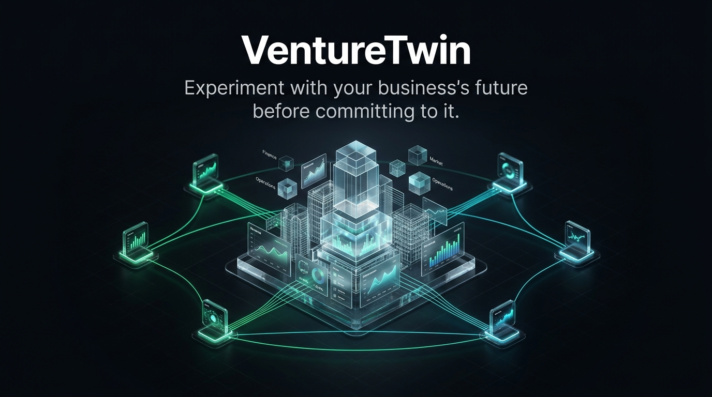
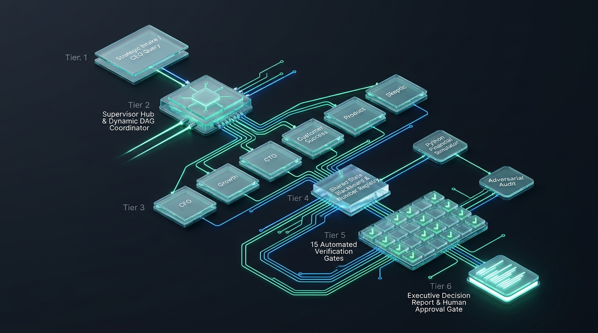
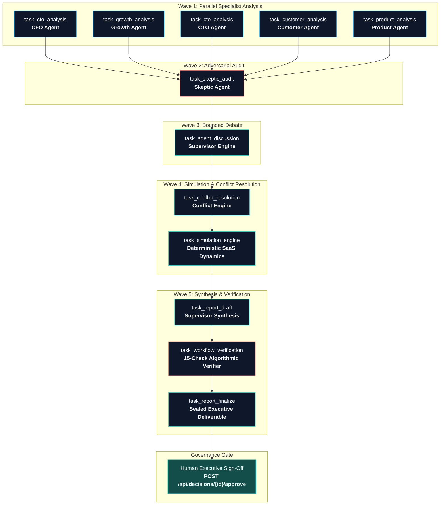
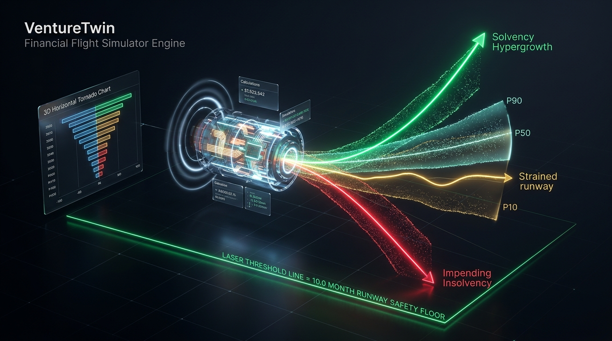

<span id="venturetwin"></span>
<p align="center">
  
</p>

<p align="center">
  <a href="https://github.com/omsrajput977/VentureTwin/actions/workflows/ci.yml"></a>
  
  
  
  
  
  
  
</p>

<p align="center">
  <a href="#1-what-is-venturetwin"><b>Overview</b></a> •
  <a href="#3-venturetwin-architecture"><b>Architecture</b></a> •
  <a href="#4-meet-the-executive-agents"><b>Executive Agents</b></a> •
  <a href="#5-interactive-boardroom--direct-dialogue"><b>Boardroom Chat</b></a> •
  <a href="#6-data-first-onboarding-engine"><b>Data Onboarding</b></a> •
  <a href="#7-what-makes-venturetwin-different"><b>Differentiators</b></a> •
  <a href="#8-simulation-engine"><b>Simulation Engine</b></a> •
  <a href="#11-quick-start"><b>Quick Start</b></a> •
  <a href="#12-testing-and-reliability"><b>Reliability</b></a>
</p>

---

## 1. What is VentureTwin?

**VentureTwin** is an AI flight simulator and operational digital twin for SaaS founders, CEOs, and executive boards. When leadership evaluates strategic, high-stakes business questions—such as *"Should we launch a free plan?"* or *"What is our maximum affordable expenditure while protecting 10 months of runway?"*—traditional decision-making fractures between subjective opinions, siloed spreadsheets, and hallucinated LLM prose.

VentureTwin unites two operational decision intelligence paradigms:

1. **Whole Board Simulation (11-Node DAG):** Orchestrates a virtual executive team (CFO, Growth, CTO, Customer Success, Product, and an adversarial Skeptic) over a topological task graph. Agents debate bounded assumptions that feed directly into a deterministic Python financial simulation engine.
2. **Interactive Boardroom & 1-on-1 Dialogue:** A Cursor-inspired executive console providing instant 1-on-1 direct dialogue with each specialist agent, grounded in real-time balance sheet telemetry and corporate context.

> [!IMPORTANT]
> **The Core Thesis:** *"Agents propose assumptions. Python calculates outcomes. Verification checks the decisions."*

```
[ Data Onboarding: Markdown / URL ] ➔ [ Company Context Store ] ➔ [ Executive Boardroom (Chat or DAG) ]
➔ [ 11-Node DAG ] ➔ [ Parallel Specialists ] ➔ [ Adversarial Audit ] ➔ [ Deterministic Simulation ]
➔ [ 15-Check Verification Gate ] ➔ [ Consolidated Report ] ➔ [ Human Sign-Off Gate ]
```

---

## 2. The Problem

High-stakes SaaS decisions fail under conventional decision frameworks:

| Failure Mode | How It Fails in Practice | VentureTwin Solution |
|:---|:---|:---|
| **Human Executive Meetings** | Politicized debates, HiPPO bias (Highest Paid Person's Opinion), and static spreadsheet models that ignore cross-departmental friction. | **Autonomous Specialist Swarm:** 7 dedicated agents evaluating decisions simultaneously across financial, infrastructure, retention, and growth constraints. |
| **Monolithic LLM Prompts** | Asking a single LLM generates agreeable essays with fabricated math, unvalidated arithmetic, and zero balance sheet accountability. | **Empirical Separation of Concerns:** LLMs propose bounded parameter assumptions `[low, base, high]`; deterministic Python runs the balance sheet. |
| **Consensus / LLM Voting** | Averaging conflicting predictions (e.g., CFO's 1.0% conversion vs. Growth's 4.8% to 2.9%) yields an ungrounded compromise no expert supports. | **Simulation-Driven Resolution:** Dual 12-to-24 month dynamic simulations test whether parameter disagreements actually flip the optimal strategic choice. |
| **Hardcoded Assumptions** | Most tools require manually hardcoding synthetic company parameters into rigid config files. | **Data-First Onboarding:** Dynamic Markdown ingestion + SSRF-safe website scraper extracting 9 core business parameters with field-level provenance. |

---

## 3. VentureTwin Architecture

VentureTwin coordinates multi-agent intelligence through a modular, decoupled architecture where qualitative reasoning, context extraction, and deterministic mathematics are strictly separated.

<p align="center">
  
</p>

### The 11-Node Execution DAG

Every full flight simulation prompt compiles into an 11-node execution graph executed across sequential dependency waves:



---

## 4. Meet the Executive Agents

Each agent is an autonomous specialist operating with isolated context, a domain-specific objective function, private tool access, and structured Pydantic communication schemas:

<p align="center">
  
</p>

| Agent | Implementation | Core Objective | Key Parameters Proposed | Private Tool Access | Direct 1-on-1 Chat |
|:---|:---|:---|:---|:---|:---:|
| **Supervisor** | [`orchestrator/supervisor.py`](orchestrator/supervisor.py) | Coordinates the DAG, detects conflicts, manages state, synthesizes findings. | State transitions, task graphs, loopback limits | Full Blackboard & SQLite State | Whole Board |
| **CFO** | [`agents/specialists.py`](agents/specialists.py) | Defends cash runway (\$1.65M) and enforces solvency guardrails (10.0-mo floor). | `free_to_paid_conversion`, `infra_cost_per_user` | `company_financials`, `cash_burn_tool` | Yes (`cfo`) |
| **Growth** | [`agents/specialists.py`](agents/specialists.py) | Maximizes acquisition velocity, signup volume, and top-of-funnel expansion. | `monthly_free_signups`, `paid_funnel_lift` | `traffic_funnel_tool`, `conversion_history` | Yes (`growth`) |
| **CTO** | [`agents/specialists.py`](agents/specialists.py) | Protects SLA stability, compute overhead, and infrastructure unit costs. | `infra_cost_per_free_user`, `usage_cap_reduction` | `infrastructure_costs`, `capacity_limits` | Yes (`cto`) |
| **Customer** | [`agents/specialists.py`](agents/specialists.py) | Prevents customer churn, protects CSAT, and models support ticket burden. | `paid_to_free_cannibalization`, `ticket_rate` | `support_tickets_tool`, `churn_telemetry` | Yes (`customer`) |
| **Product** | [`agents/specialists.py`](agents/specialists.py) | Designs tier boundaries, upgrade gating, and feature monetization elasticity. | `activation_drop_gating`, `cap_conversion_uplift` | `feature_usage_tool`, `tier_matrix` | Yes (`product`) |
| **Skeptic** | [`agents/specialists.py`](agents/specialists.py) | Adversarially stress-tests claims, applies confidence haircuts, challenges provenance. | Challenges optimistic assumptions, emits critiques | `provenance_audit_tool`, `cross_examiner` | Yes (`skeptic`) |
| **Backup Analyst** | [`agents/backup_agent.py`](agents/backup_agent.py) | Autonomous failover agent activated upon specialist timeout or API rate limit. | Adaptive fallback parameter distributions | `domain_priors_tool`, `benchmarks` | Yes (`backup`) |

---

## 5. Interactive Boardroom & Direct Dialogue

The **Executive Boardroom** ([`ui/src/components/mission/BoardroomPanel.tsx`](ui/src/components/mission/BoardroomPanel.tsx)) provides a Cursor-inspired sliding panel on the right side of the workspace:

- **Mode Selector (Downward-Opening Dropdown):** Seamlessly toggle between **Whole Board (11-Node DAG)** full orchestration and private **1-on-1 Direct Dialogue** with any of the 7 executive specialists.
- **Dynamic Context Grounding:** Every direct conversation is automatically grounded in the active company's balance sheet, MRR, cash reserves, and unit economics via [`services/agent_chat.py`](services/agent_chat.py).
- **Sub-Second Streaming:** Real-time typewriter pacing and conversation history for iterative strategy stress-testing.

> 📖 **Deep Dive:** Read [`docs/BOARDROOM.md`](docs/BOARDROOM.md) for full persona prompts, grounding mechanics, and API details.

---

## 6. Data-First Onboarding Engine

Rather than forcing users into hardcoded demonstration files, VentureTwin features a **Data-First Onboarding Engine**:

- **Markdown Document Ingestion ([`services/company_extractor.py`](services/company_extractor.py)):** Drag and drop corporate strategy memos, pitch decks, or financial updates. An automated extractor parses 9 core fields (`company_name`, `industry`, `business_model`, `description`, `products_services`, `target_customers`, `revenue_model`, `stage`, `strategic_goals`).
- **SSRF-Protected Website Scraper ([`services/website_scraper.py`](services/website_scraper.py)):** Enter any corporate website URL. The engine crawls public metadata, headers, and positioning with comprehensive private IP and loopback guards.
- **Context Store & Multi-Profile Persistence ([`services/company_context_store.py`](services/company_context_store.py)):** Extracted company contexts are stored in SQLite (`venturetwin_company_context.db`), with verified field provenance tags (`uploaded_documents`, `website_scrape`, `manual_edit`).
- **NimbusDesk Reference Baseline ([`data/loader.py`](data/loader.py)):** If no custom context is connected, the platform seamlessly defaults to the verified Series A benchmark for instant evaluation.

> 📖 **Deep Dive:** Read [`docs/DATA_ONBOARDING.md`](docs/DATA_ONBOARDING.md) for full extraction schemas, SSRF rules, and API specifications.

---

## 7. What Makes VentureTwin Different?

<p align="center">
  
</p>

1. **Empirical Conflict Resolution (No Voting):** When the CFO and Growth agents disagree on free-to-paid conversion (1.0% vs. 4.8%), VentureTwin evaluates both extremes in parallel 12-to-24 month SaaS models. If Strategy B (Usage Caps) yields superior Net Contribution under *both* assumptions, the conflict is classified as **`decided_by_simulation`** (Decision Invariant), eliminating arbitrary voting.
2. **Deterministic Mathematical Engine:** Pure Python in [`simulation/saas_model.py`](simulation/saas_model.py) computes cash burn, MRR, churn, and runway. LLMs are prohibited from performing financial calculations.
3. **Cryptographic Number Registry:** Every quantitative figure in the final deliverable is registered in [`report/number_registry.py`](report/number_registry.py) with source provenance (`verified_data`, `ai_assumption`, `simulation_output`, or `external_research`).
4. **15 Algorithmic Verification Checks:** [`verification/verifier.py`](verification/verifier.py) runs an automated 15-check audit matrix (units, math balance, solvency floors, prose numbers, and report completeness).
5. **Human-in-the-Loop Governance:** Autonomous execution halts at `pending_approval`. Decisions cannot take effect without explicit human executive sign-off (`POST /api/decisions/{id}/approve`).

---

## 8. Simulation Engine

VentureTwin evaluates strategy branches against dynamic company profiles or the calibrated Series A benchmark: **NimbusDesk**.

<p align="center">
  
</p>

### Verified Benchmark Baseline (NimbusDesk)

```text
Cash Balance:                $1,650,000      Current MRR:         $110,370 ($1.32M ARR)
Monthly Net Burn:              $125,000      Paying Customers:                         655
Current Runway:             13.2 months      Customer Acquisition Cost (CAC):       $1,450
Minimum Runway Constraint:  10.0 months      Cloud Infrastructure Burn:         $14,500/mo
Max Additional Expenditure:  $40,000/mo      ($1,650,000 / 10.0mo - $125,000 = $40,000/mo)
```

### Deterministic & Stochastic Flight Charts

All charts are generated deterministically from verified simulation runs (seed=42):

| 1. Tornado Sensitivity Matrix | 2. Strategy Scenario Comparison |
|:---:|:---:|
|  |  |
| *Ranks financial swing of agent assumptions on 12-mo contribution* | *Conservative, Expected, and Optimistic 12-month net outcomes* |

| 3. Monte Carlo 500-Run Quantiles | 4. Cash Runway & Solvency Boundary |
|:---:|:---:|
|  |  |
| *P10, P50, and P90 stochastic bands over 500 random draws* | *24-month cash runway tracking against the 10.0-month safety floor* |

---

## 9. Product Tour & Screenshots

The VentureTwin React dashboard provides end-to-end visibility into the multi-agent decision lifecycle:

<div align="center">

| Strategic Intake & Preset Scenarios | Active Multi-Agent Execution DAG |
|:---:|:---:|
|  |  |
| *Natural language intake with quick-start strategic presets* | *Live DAG tracking parallel agent waves and execution states* |

| Completed 11-Node Decision Topology | Specialist Finding Inspector Modal |
|:---:|:---:|
|  |  |
| *Full execution graph resolved with audit and verification passes* | *Inspect bounded assumptions, confidence ratings, and provenance* |

</div>

<details>
<summary><b>🔍 View Additional Telemetry Views (Live Event Stream & Domain Inspectors)</b></summary>
<br/>

| Real-Time Event Stream (SSE) | Head of Growth Finding Inspector | VP Customer Success Finding Inspector |
|:---:|:---:|:---:|
|  |  |  |
| *Real-time SSE event log* | *Top-of-funnel acquisition bounds* | *Cannibalization and ticket ratios* |

</details>

---

## 10. Technology Stack

Verified directly from [`pyproject.toml`](pyproject.toml) and [`ui/package.json`](ui/package.json):

| Subsystem | Technology | Verified Version | Architectural Role |
|:---|:---|:---:|:---|
| **Runtime** | Python | `3.13.5` | Core language runtime |
| **API Framework** | FastAPI | `0.162.2` | High-performance asynchronous REST & SSE streaming server |
| **ASGI Server** | Uvicorn | `0.54.0` | Production ASGI web application server |
| **Type Validation** | Pydantic | `2.14.3` | Bounded parameter schemas, finding models, contract enforcement |
| **Services Layer** | Custom Services | `services/` | Context extraction, website scraping, multi-profile store & agent chat |
| **Scientific Math** | NumPy / SciPy | `2.5.4` / `1.18.1` | Monte Carlo distributions, quantile calculations, sensitivity sweeps |
| **Async HTTP** | HTTPX | `0.28.1` | Non-blocking LLM provider communications with retry management |
| **Test Harness** | Pytest / Pytest-Asyncio | `9.2.0` / `0.25.3` | 203 unit, integration, invariant, onboarding, and chaos tests |
| **Frontend UI** | React / React-DOM | `19.0.0` | Cursor-inspired reactive mission-control interface |
| **Frontend Tooling** | Vite / TypeScript | `6.4.5` / `5.7.0` | Lightning-fast HMR bundler and strict end-to-end type contracts |
| **UI Styling** | Tailwind CSS | `3.4.17` | Obsidian dark-mode design system (`#121212`, `#141414`) |
| **Persistence** | SQLite | `3.x` | Checkpoints, executive auth, and company context stores |

---

## 11. Quick Start

Run VentureTwin locally in **mock mode** with zero external API keys required:

### 1. Clone & Set Up Backend

```bash
git clone https://github.com/omsrajput977/VentureTwin.git
cd VentureTwin

# Initialize Python virtual environment
python3 -m venv .venv
source .venv/bin/activate

# Install verified dependencies
pip install -r requirements.txt
```

### 2. Set Up Frontend

```bash
cd ui
npm install
npm run build
cd ..
```

### 3. Launch Services

```bash
# Terminal 1: Launch FastAPI Backend (Defaults to Mock Mode)
uvicorn api.app:app --host 0.0.0.0 --port 8000 --reload

# Terminal 2: Launch React Frontend (For Live HMR Development)
npm --prefix ui run dev
```

Open **`http://localhost:5173`** (or **`http://localhost:8000`**) in your browser. Verify backend health with:

```bash
curl http://localhost:8000/api/health
# {"status":"ok","version":"0.1.0","llm_mode":"mock",...}
```

### Running with Real LLMs (Google Gemini, OpenAI, Groq, Cerebras)

To connect live models, update `.env` in the project root:

```env
LLM_MODE=real
LLM_PROVIDER=gemini
GEMINI_API_KEY=your_gemini_api_key_here
GEMINI_MODEL=gemini-2.5-flash
```

Test your provider credentials:

```bash
python3 scripts/check_provider.py
```

> [!TIP]
> Use **`LLM_MODE=record`** once to record live LLM responses into [`tests/cassettes/`](tests/cassettes/), then switch to **`LLM_MODE=replay`** for zero-latency, rate-limit-free demonstrations.

---

## 12. Testing and Reliability

VentureTwin maintains rigorous automated testing and algorithmic verification across 203 automated tests:

```bash
# Execute the complete automated test suite
pytest tests/ -q
# 203 passed, 3 skipped in 16.56s
```

### The 15 Algorithmic Verification Checks

Implemented in [`verification/verifier.py`](verification/verifier.py), these checks run automatically on every report draft:

```text
 1. verify_units                              9. verify_financial_reconciliation
 2. verify_company_financial_tie_outs       10. verify_runway_integrity
 3. verify_provenance_integrity              11. verify_assumption_consistency
 4. verify_report_data_traceability          12. verify_numerical_claim_traceability
 5. verify_required_sections                 13. verify_agent_participation_integrity
 6. verify_number_registry                   14. verify_simulation_reproducibility
 7. verify_prose_numbers                     15. verify_recommendation_constraints
 8. verify_decision_consistency
```

### Automated UI Number Verification

Run before every frontend build to ensure no hardcoded metric values exist in React components:

```bash
node ui/scripts/check-no-fake-numbers.mjs
# Pass: All displayed values trace to dynamic backend API responses
```

---

## 13. Limitations & Roadmap

### Transparent Limitations
1. **SaaS Dynamics Focus:** The deterministic model specializes in subscription economics (churn, CAC, ARPU, support load, infra scaling). It is not designed for hardware manufacturing, crypto, or biotech modeling.
2. **Scenarios, Not Crystal Balls:** Monte Carlo distributions project mathematical outcomes of stated assumptions under statistical distributions; they are decision stress-tests, not macroeconomic forecasts.
3. **Single-Tenant Local Execution:** Optimized for local evaluation with SQLite; does not include enterprise multi-tenant cloud SSO.

### Implemented vs. Planned Capabilities
- `[IMPLEMENTED]` **Data-First Onboarding:** Automated Markdown parsing and SSRF-safe website scraper.
- `[IMPLEMENTED]` **Direct Agent Dialogue:** 1-on-1 grounded executive chat in the Cursor Boardroom panel.
- `[IMPLEMENTED]` **Executive Authentication:** PBKDF2-SHA256 password hashing with 30-day session persistence.
- `[PLANNED]` **Live Stripe & CRM Telemetry Connectors:** Direct real-time sync with Stripe, HubSpot, and Datadog APIs.
- `[PLANNED]` **Autonomous Decision Backtesting:** Comparing past simulated recommendations against actual company performance to dynamically calibrate agent confidence weights.

---

## 14. Key Documentation & Team

### Documentation Hub
- **[`docs/PITCH.md`](docs/PITCH.md)** — **Executive Pitch & Judge Q&A Guide:** 3-minute plain-English walkthrough with judge questions and sharp answers.
- **[`docs/TECHSTACK.md`](docs/TECHSTACK.md)** — **Tech Stack & Engineering Tradeoffs:** Detailed justifications, communication protocols, and empirical conflict resolution.
- **[`docs/DATA_ONBOARDING.md`](docs/DATA_ONBOARDING.md)** — **Data-First Onboarding Guide:** Markdown ingestion, SSRF-safe scraper, and context store architecture.
- **[`docs/BOARDROOM.md`](docs/BOARDROOM.md)** — **Executive Boardroom Specification:** Whole Board DAG coordination vs direct 1-on-1 agent dialogue.
- **[`docs/ARCHITECTURE.md`](docs/ARCHITECTURE.md)** — **Complete Technical Specification:** Comprehensive system architecture specification.

### Team & Acknowledgements
- **Built by:** Om Rajput ([@omsrajput977](https://github.com/omsrajput977))
- **Submission for:** *SwarmFlow: Multi-Agent Task Coordination Engine Hackathon (2026)*
- **License:** Open source under the **[MIT License](LICENSE)**.
- **Acknowledgements:** Google DeepMind & Google AI Studio for the Gemini API platform.

---

<p align="center">
  
</p>

<p align="center">
  <a href="#venturetwin"><b>Back to Top ⬆️</b></a>
</p>
