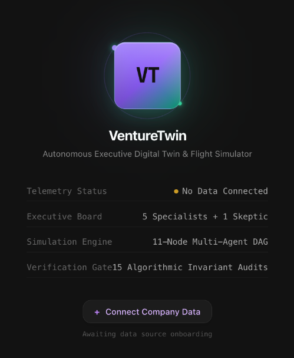
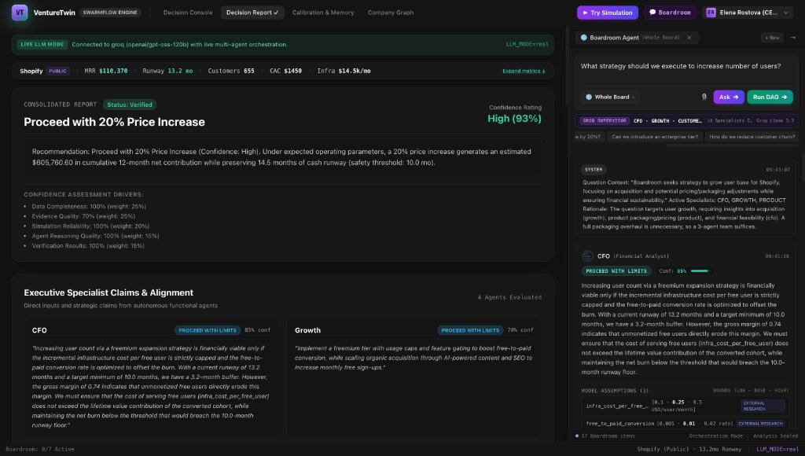
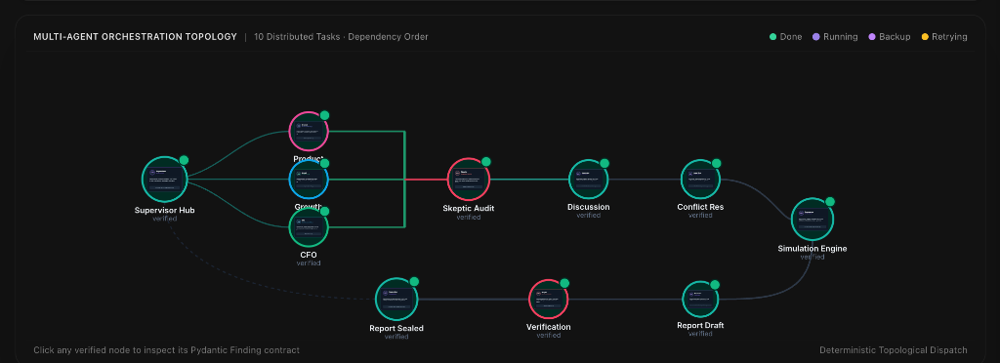
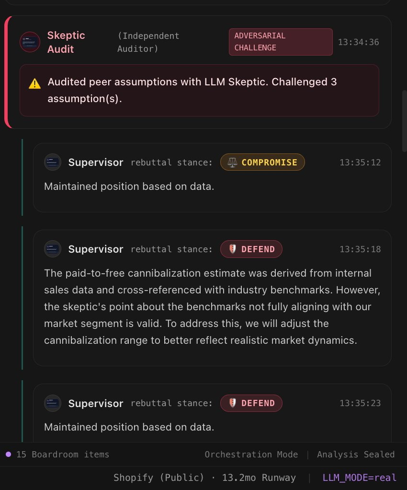
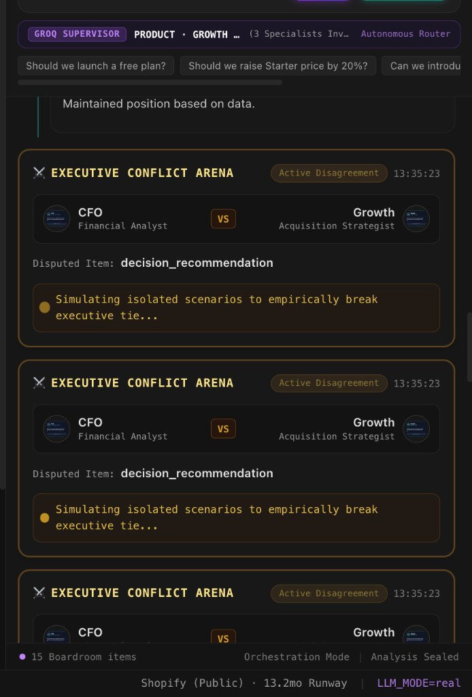
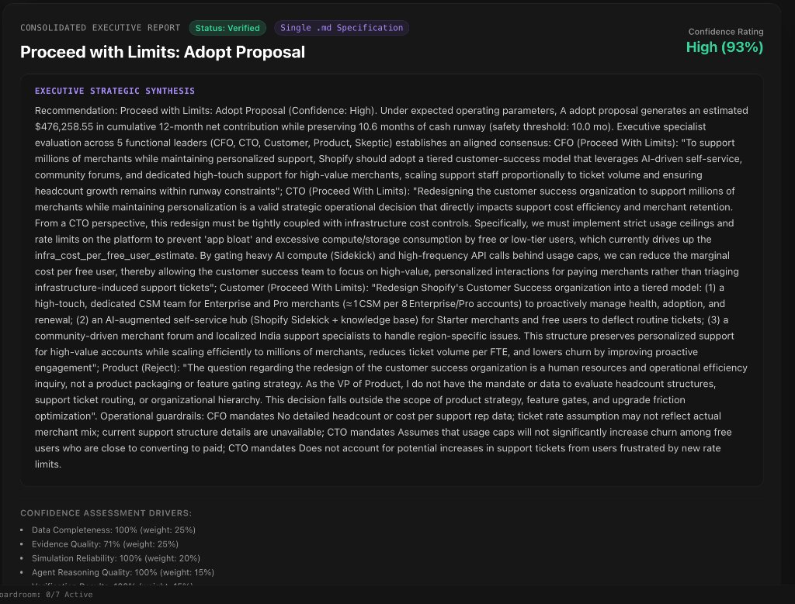
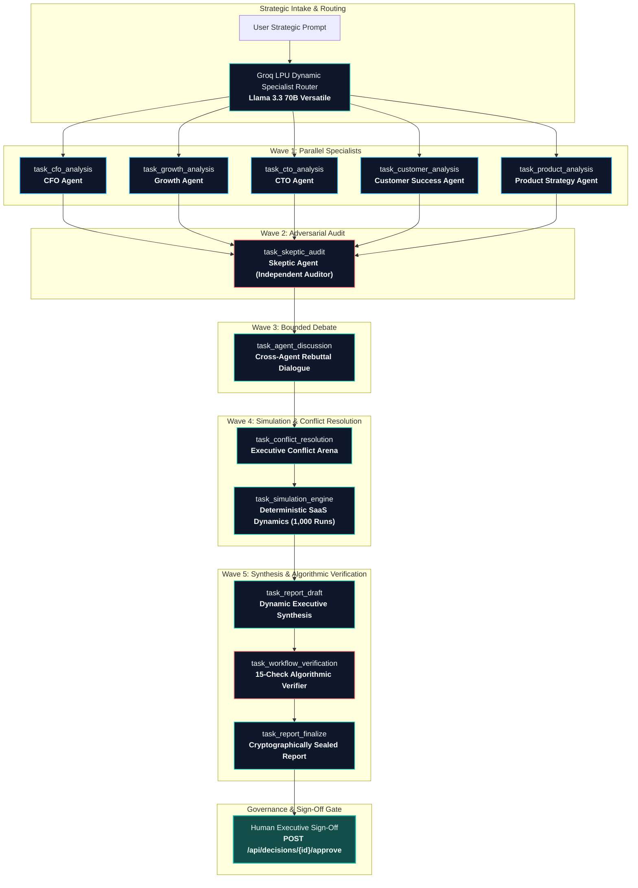
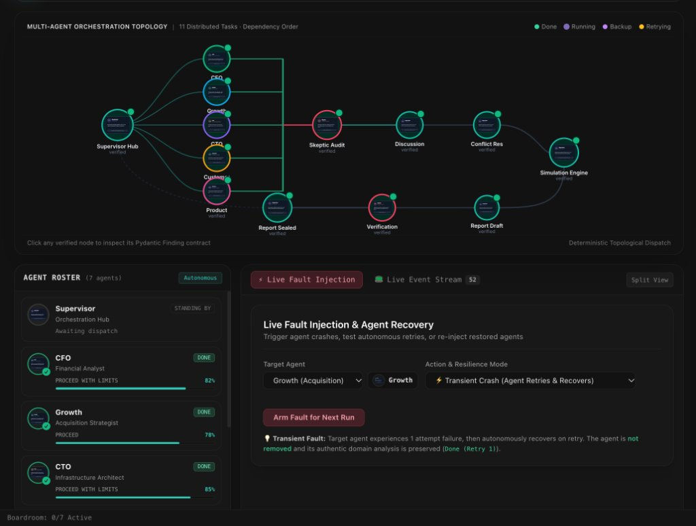

<span id="venturetwin"></span>
<p align="center">
  
</p>

<p align="center">
  <a href="https://github.com/omsrajput977/VentureTwin/actions/workflows/ci.yml"></a>
  
  
  
  
  
  
  
  
</p>

<p align="center">
  <a href="#1-what-is-venturetwin"><b>Overview</b></a> •
  <a href="#2-the-multi-agent-orchestration-workflow"><b>Multi-Agent Workflow</b></a> •
  <a href="#3-venturetwin-architecture"><b>Architecture</b></a> •
  <a href="#4-meet-the-executive-agents"><b>Executive Swarm</b></a> •
  <a href="#5-empirical-conflict-resolution--the-executive-conflict-arena"><b>Conflict Arena</b></a> •
  <a href="#6-interactive-boardroom--direct-dialogue"><b>Boardroom Chat</b></a> •
  <a href="#7-data-first-onboarding-engine"><b>Data Onboarding</b></a> •
  <a href="#8-simulation-engine"><b>Simulation Engine</b></a> •
  <a href="#9-enterprise-reliability--fault-injection"><b>Chaos Recovery</b></a> •
  <a href="#11-quick-start"><b>Quick Start</b></a> •
  <a href="#12-testing-and-reliability"><b>Reliability</b></a>
</p>

---

## 1. What is VentureTwin?

**VentureTwin** is an AI flight simulator and operational digital twin for SaaS founders, CEOs, and executive boards. When leadership evaluates strategic, high-stakes business questions—such as *"Should we launch a freemium tier?"*, *"How should we restructure pricing to increase ARR?"*, or *"What is our maximum affordable expenditure while protecting 10 months of cash runway?"*—traditional decision-making fractures between subjective opinions, siloed spreadsheets, and hallucinated LLM prose.

VentureTwin unites two operational decision intelligence paradigms:

1. **Autonomous Multi-Agent Swarm (10-to-11 Task Distributed DAG):** Orchestrates a virtual executive team (CFO, Growth, CTO, Customer Success, Product, and an adversarial Skeptic) over a topological dependency graph. Powered by Groq LPU dynamic specialist routing, cross-agent adversarial auditing, debate rebuttals, conflict resolution arenas, and deterministic SaaS dynamic simulation.
2. **Interactive Boardroom & 1-on-1 Dialogue:** A Cursor-inspired executive console providing instant, sub-second dialogue with the Whole Board or 1-on-1 private consultations with individual specialist agents, strictly grounded in real-time balance sheet telemetry and corporate context.

> [!IMPORTANT]
> **The Core Architectural Thesis:**
> *"Agents propose bounded assumptions. Deterministic Python calculates outcomes. Algorithmic verification checks the decisions."*

<p align="center">
  
</p>

```
[ User Strategic Question ] ➔ [ Groq LPU Dynamic Specialist Router ]
➔ [ Wave 1: Parallel Specialists (CFO, Growth, CTO, Customer, Product) ]
➔ [ Wave 2: Skeptic Adversarial Audit (Challenges Unbacked Assumptions) ]
➔ [ Wave 3: Cross-Agent Debate & Bounded Rebuttals (Defend / Compromise) ]
➔ [ Wave 4: Executive Conflict Arena (Simulation-Driven Tie Breaking) ]
➔ [ Wave 5: Deterministic Python SaaS Engine (1,000 Monte Carlo Runs) ]
➔ [ Wave 6: Dynamic Executive Strategic Synthesis (Consolidated Report) ]
➔ [ Wave 7: 15-Check Algorithmic Verification Gate & Cryptographic Seal ]
```

---

## 2. The Multi-Agent Orchestration Workflow

VentureTwin replaces passive, monolithic single-prompt LLMs with an authentic, multi-stage distributed multi-agent coordination pipeline. Every decision follows a deterministic 8-phase execution topology:

<p align="center">
  
</p>

### Phase 1: Strategic Question Intake & Groq LPU Dynamic Specialist Routing
- The user inputs any strategic SaaS question into the Boardroom console (e.g., *"What strategy should we execute to increase number of users?"* or *"How should Shopify restructure its financial services ecosystem to become a more comprehensive financial partner for merchants?"*).
- Rather than blindly invoking every agent for every trivial query, the **Supervisor Agent** (accelerated by Groq LPU running Llama 3.3) analyzes the inquiry, determines the business context, and dynamically routes sub-tasks exclusively to the relevant specialist agents (e.g., CFO for unit economics, Growth for top-of-funnel acquisition, Product for tier boundaries).
- The Boardroom UI immediately updates with dynamic specialist badges (`[GROQ SUPERVISOR]`, `[CFO]`, `[GROWTH]`, `[PRODUCT]`) and transparent router rationale.

### Phase 2: Parallel Specialist Execution & Bounded Assumptions
- Selected functional agents execute concurrently in **Wave 1**, isolated from peer biases.
- Each agent queries the company's financial balance sheet, historical telemetry, and private tools.
- Crucially, agents do **not** calculate final cash balances or financial formulas. Instead, they propose **strictly bounded parameter assumptions** `[low, base, high]`, qualitative arguments, confidence ratings, and operational mandates enforced by strict Pydantic schemas.

### Phase 3: Skeptic Adversarial Audit
<p align="center">
  
</p>

- Once specialist claims are registered on the shared Blackboard, the **Skeptic Agent** (Wave 2) launches an independent adversarial audit.
- The Skeptic inspects every assumption, cross-referencing industry benchmarks and historical data to flag aggressive optimism (e.g., challenging an unrealistic 4.8% free-to-paid conversion rate or under-projected server overhead).
- **Adversarial Challenge Notification:** The Skeptic outputs explicit challenge alerts (e.g., *"⚠️ Audited peer assumptions with LLM Skeptic. Challenged 3 assumption(s)."*), holding specialists accountable.

### Phase 4: Cross-Agent Discussion & Bounded Rebuttals
- In **Wave 3**, challenged specialists receive the Skeptic's audit notes and enter a structured debate round.
- Agents respond with bounded tactical stances:
  - **`DEFEND`:** Maintain position with verifiable empirical data or domain precedents.
  - **`COMPROMISE`:** Acknowledge valid skepticism and adjust parameter boundaries (e.g., widening paid-to-free cannibalization ranges to reflect market variance).
  - **`CONCEDE`:** Retract indefensible assumptions before the simulation runs.

### Phase 5: Executive Conflict Arena & Simulation-Driven Tie Breaking
<p align="center">
  
</p>

- When functional specialists hold conflicting recommendations—such as the CFO mandating strict runway preservation (`PROCEED WITH LIMITS`) while Growth advocates aggressive expansion (`PROCEED`)—the Supervisor activates the **Executive Conflict Arena**.
- **No Majority Voting. No LLM Averaging:** Human executive teams compromise by averaging numbers; standard AI agents compromise by hallucinating consensus. VentureTwin rejects both.
- The engine dispatches the disputed parameter sets into isolated 12-to-24 month SaaS simulations. If both models demonstrate that a strategy preserves runway while generating superior net contribution, the conflict is marked **`decided_by_simulation`** (Decision Invariant). If one hypothesis breaches the 10-month runway floor, it is objectively discarded.

### Phase 6: Deterministic SaaS Simulation Engine & Monte Carlo
- The verified assumption vectors are injected into pure Python mathematical models ([`simulation/saas_model.py`](simulation/saas_model.py)).
- Zero LLM math: The deterministic engine computes monthly recurring revenue (MRR), net churn, cloud infrastructure costs, customer acquisition payback, and cash burn over 12 and 24 months across 1,000 Monte Carlo runs (seed=42).

### Phase 7: Dynamic Executive Strategic Synthesis
<p align="center">
  
</p>

- In **Wave 5**, the Supervisor Agent synthesizes the collective intelligence of the board into a dynamic, tailored **Consolidated Executive Report**.
- **100% Dynamic & Topic-Grounded:** All hardcoded boilerplate and static templates have been eradicated. The report extracts the dynamic inquiry topic, presents a definitive verdict with exact financial tie-outs, summarizes the individual contributions of all active specialists (CFO, CTO, Customer, Product, Growth, Skeptic), and itemizes non-negotiable operational guardrails.
- **Multi-Factor Confidence Scoring:** Computes an empirical confidence rating (e.g., **High 93%**) based on five explicit weighted drivers:
  - Data Completeness (25%)
  - Evidence Quality (25%)
  - Simulation Reliability (20%)
  - Agent Reasoning Quality (15%)
  - Verification Results (15%)

### Phase 8: 15-Check Verification Gate & Cryptographic SHA-256 Seal
- Before any deliverable reaches leadership, [`verification/verifier.py`](verification/verifier.py) runs an automated **15-check verification matrix**.
- Checks verify mathematical consistency, unit balance, provenance integrity, number registry traceability, and solvency constraints.
- Once verified, the report receives a cryptographic SHA-256 hash seal, unlocks the **`Status: Verified`** badge, and allows instantaneous download as a clean, stand-alone `.md` executive specification.

---

## 3. VentureTwin Architecture

VentureTwin coordinates multi-agent intelligence through a modular, decoupled architecture where qualitative reasoning, context extraction, and deterministic mathematics are strictly separated:



---

## 4. Meet the Executive Agents

Each executive agent operates with isolated domain context, private tool access, and structured Pydantic communication schemas:

| Agent | Implementation | Core Executive Mandate | Bounded Parameters Proposed | Private Tool Access | Direct 1-on-1 Chat |
|:---|:---|:---|:---|:---|:---:|
| **Supervisor** | [`orchestrator/supervisor.py`](orchestrator/supervisor.py) | Dynamic task routing, DAG state management, debate orchestration, synthesis. | State transitions, task graphs, loopback limits | Full Blackboard & SQLite State | Whole Board |
| **CFO** | [`agents/specialists.py`](agents/specialists.py) | Defends cash runway (\$1.65M) and enforces solvency guardrails (10.0-mo floor). | `free_to_paid_conversion`, `infra_cost_per_user` | `company_financials`, `cash_burn_tool` | Yes (`cfo`) |
| **Growth** | [`agents/specialists.py`](agents/specialists.py) | Maximizes acquisition velocity, signup volume, and top-of-funnel expansion. | `monthly_free_signups`, `paid_funnel_lift` | `traffic_funnel_tool`, `conversion_history` | Yes (`growth`) |
| **CTO** | [`agents/specialists.py`](agents/specialists.py) | Protects SLA stability, compute overhead, and infrastructure unit scaling. | `infra_cost_per_free_user`, `usage_cap_reduction` | `infrastructure_costs`, `capacity_limits` | Yes (`cto`) |
| **Customer** | [`agents/specialists.py`](agents/specialists.py) | Prevents customer churn, protects CSAT, and models support ticket burden. | `paid_to_free_cannibalization`, `ticket_rate` | `support_tickets_tool`, `churn_telemetry` | Yes (`customer`) |
| **Product** | [`agents/specialists.py`](agents/specialists.py) | Designs tier boundaries, upgrade gating, and feature monetization elasticity. | `activation_drop_gating`, `cap_conversion_uplift` | `feature_usage_tool`, `tier_matrix` | Yes (`product`) |
| **Skeptic** | [`agents/specialists.py`](agents/specialists.py) | Adversarially stress-tests peer assumptions, applies haircuts, audits provenance. | Challenges optimistic assumptions, emits critique | `provenance_audit_tool`, `cross_examiner` | Yes (`skeptic`) |
| **Backup Analyst** | [`agents/backup_agent.py`](agents/backup_agent.py) | Autonomous failover agent activated upon specialist timeout or API rate limit. | Adaptive fallback parameter distributions | `domain_priors_tool`, `benchmarks` | Yes (`backup`) |

---

## 5. Empirical Conflict Resolution: The Executive Conflict Arena

Conventional multi-agent systems rely on majority voting or LLM summarization when agents disagree. Both approaches produce dangerous, ungrounded compromises:

| Traditional Approach | What Happens When CFO & Growth Disagree | The Resulting Flaw |
|:---|:---|:---|
| **Majority Voting** | 3 non-financial agents outvote the CFO's runway warning. | Company breaches its cash safety floor and runs out of runway. |
| **Monolithic LLM Averaging** | Blends 1.0% conversion (CFO) and 4.8% (Growth) into 2.9%. | Arbitrary synthetic number with zero empirical basis. |
| **VentureTwin Conflict Arena** | Dispatches both parameter sets into isolated 12-month simulations. | Resolves disagreements empirically based on mathematical outcomes. |

When a conflict is detected on the blackboard:
1. The **Executive Conflict Arena** flags the active disagreement and disputed parameters.
2. The simulation engine runs independent Monte Carlo projections under each specialist's assumptions.
3. If the decision recommendation remains invariant across both conditions, the dispute is marked `decided_by_simulation`, proving the disagreement does not alter the strategic choice.
4. If one scenario violates cash solvency constraints, the engine automatically enforces the safety constraint.

---

## 6. Interactive Boardroom & Direct Dialogue

The **Executive Boardroom** ([`ui/src/components/mission/BoardroomPanel.tsx`](ui/src/components/mission/BoardroomPanel.tsx)) provides an interactive sliding mission console:

- **Mode Selector:** Seamlessly switch between **Whole Board (10-to-11 Task DAG)** full orchestration and private **1-on-1 Direct Dialogue** with any of the 7 executive specialists.
- **Dynamic Balance Sheet Grounding:** Every direct dialogue session is grounded in real-time corporate telemetry, cash reserves, and unit economics via [`services/agent_chat.py`](services/agent_chat.py).
- **Sub-Second Streaming:** Real-time typewriter pacing and conversation history for iterative strategy stress-testing.

> 📖 **Deep Dive:** Read [`docs/BOARDROOM.md`](docs/BOARDROOM.md) for full persona prompts, grounding mechanics, and API details.

---

## 7. Data-First Onboarding Engine

Rather than forcing users into hardcoded demonstration files, VentureTwin features a **Data-First Onboarding Engine**:

- **Markdown Document Ingestion ([`services/company_extractor.py`](services/company_extractor.py)):** Drag and drop corporate strategy memos, pitch decks, or financial updates. An automated extractor parses 9 core fields (`company_name`, `industry`, `business_model`, `description`, `products_services`, `target_customers`, `revenue_model`, `stage`, `strategic_goals`).
- **SSRF-Protected Website Scraper ([`services/website_scraper.py`](services/website_scraper.py)):** Enter any corporate website URL. The engine crawls public metadata, headers, and positioning with comprehensive private IP and loopback guards.
- **Context Store & Multi-Profile Persistence ([`services/company_context_store.py`](services/company_context_store.py)):** Extracted company contexts are stored in SQLite (`venturetwin_company_context.db`), with verified field provenance tags (`uploaded_documents`, `website_scrape`, `manual_edit`).
- **NimbusDesk Reference Baseline ([`data/loader.py`](data/loader.py)):** If no custom context is connected, the platform seamlessly defaults to the verified Series A benchmark for instant evaluation.

> 📖 **Deep Dive:** Read [`docs/DATA_ONBOARDING.md`](docs/DATA_ONBOARDING.md) for full extraction schemas, SSRF rules, and API specifications.

---

## 8. Simulation Engine

VentureTwin evaluates strategy branches against dynamic company profiles or the calibrated Series A benchmark: **NimbusDesk**.

### Verified Benchmark Baseline (NimbusDesk)

```text
Cash Balance:                $1,650,000      Current MRR:         $110,370 ($1.32M ARR)
Monthly Net Burn:              $125,000      Paying Customers:                         655
Current Runway:             13.2 months      Customer Acquisition Cost (CAC):       $1,450
Minimum Runway Constraint:  10.0 months      Cloud Infrastructure Burn:         $14,500/mo
Max Additional Expenditure:  $40,000/mo      ($1,650,000 / 10.0mo - $125,000 = $40,000/mo)
```

### Deterministic & Stochastic Flight Charts

All charts are generated deterministically from verified simulation runs (seed=42):

| 1. Tornado Sensitivity Matrix | 2. Strategy Scenario Comparison |
|:---:|:---:|
|  |  |
| *Ranks financial swing of agent assumptions on 12-mo contribution* | *Conservative, Expected, and Optimistic 12-month net outcomes* |

| 3. Monte Carlo 500-Run Quantiles | 4. Cash Runway & Solvency Boundary |
|:---:|:---:|
|  |  |
| *P10, P50, and P90 stochastic bands over 500 random draws* | *24-month cash runway tracking against the 10.0-month safety floor* |

---

## 9. Enterprise Reliability & Fault Injection

VentureTwin includes an integrated Chaos Engineering & Fault Injection harness ([`orchestrator/fault_injector.py`](orchestrator/fault_injector.py)) to guarantee enterprise resilience:

<p align="center">
  
</p>

- **Simulate Provider Failure:** Injects transient 500/503 errors on external LLM calls.
- **Force Agent Failure:** Simulates specialist crashes; triggers automatic failover to the autonomous **Backup Analyst** agent.
- **Latency Spikes & Context Truncation:** Tests circuit breakers and ensures graph recovery within bounded SLAs.
- **Telemetry & Self-Healing:** The supervisor monitors node health, retries transient faults with exponential backoff, and ensures zero unhandled exceptions reach the user.

---

## 10. Technology Stack

Verified directly from [`pyproject.toml`](pyproject.toml) and [`ui/package.json`](ui/package.json):

| Subsystem | Technology | Verified Version | Architectural Role |
|:---|:---|:---:|:---|
| **Runtime** | Python | `3.13.5` | Core language runtime |
| **API Framework** | FastAPI | `0.162.2` | High-performance asynchronous REST & SSE streaming server |
| **LPU Acceleration** | Groq LPU | `llama-3.3-70b-versatile` | Sub-second dynamic specialist routing and executive synthesis |
| **ASGI Server** | Uvicorn | `0.54.0` | Production ASGI web application server |
| **Type Validation** | Pydantic | `2.14.3` | Bounded parameter schemas, finding models, contract enforcement |
| **Services Layer** | Custom Services | `services/` | Context extraction, website scraping, multi-profile store & agent chat |
| **Scientific Math** | NumPy / SciPy | `2.5.4` / `1.18.1` | Monte Carlo distributions, quantile calculations, sensitivity sweeps |
| **Async HTTP** | HTTPX | `0.28.1` | Non-blocking LLM provider communications with retry management |
| **Test Harness** | Pytest / Pytest-Asyncio | `9.2.0` / `0.25.3` | **231 unit, integration, invariant, onboarding, and chaos tests** |
| **Frontend UI** | React / React-DOM | `19.0.0` | Cursor-inspired reactive mission-control interface |
| **Frontend Tooling** | Vite / TypeScript | `6.4.5` / `5.7.0` | Lightning-fast HMR bundler and strict end-to-end type contracts |
| **UI Styling** | Tailwind CSS | `3.4.17` | Obsidian dark-mode design system (`#121212`, `#141414`) |
| **Persistence** | SQLite | `3.x` | Checkpoints, executive auth, and company context stores |

---

## 11. Quick Start

Run VentureTwin locally in **mock mode** with zero external API keys required:

### 1. Clone & Set Up Backend

```bash
git clone https://github.com/omsrajput977/VentureTwin.git
cd VentureTwin

# Initialize Python virtual environment
python3 -m venv .venv
source .venv/bin/activate

# Install verified dependencies
pip install -r requirements.txt
```

### 2. Set Up Frontend

```bash
cd ui
npm install
npm run build
cd ..
```

### 3. Launch Services

```bash
# Terminal 1: Launch FastAPI Backend (Defaults to Mock Mode)
uvicorn api.app:app --host 0.0.0.0 --port 8000 --reload

# Terminal 2: Launch React Frontend (For Live HMR Development)
npm --prefix ui run dev
```

Open **`http://localhost:5173`** (or **`http://localhost:8000`**) in your browser. Verify backend health with:

```bash
curl http://localhost:8000/api/health
# {"status":"ok","version":"0.1.0","llm_mode":"mock",...}
```

### Running with Real LLMs (Groq, Google Gemini, OpenAI, Cerebras)

To connect live models, configure your `.env` in the project root:

```env
LLM_MODE=real
LLM_PROVIDER=groq
GROQ_API_KEY=your_groq_api_key_here
GROQ_MODEL=llama-3.3-70b-versatile
```

Test your provider credentials:

```bash
python3 scripts/check_provider.py
```

> [!TIP]
> Use **`LLM_MODE=record`** once to record live LLM responses into [`tests/cassettes/`](tests/cassettes/), then switch to **`LLM_MODE=replay`** for zero-latency, rate-limit-free demonstrations.

---

## 12. Testing and Reliability

VentureTwin maintains rigorous automated testing and algorithmic verification across 231 automated tests:

```bash
# Execute the complete automated test suite
pytest tests/ -q
# 231 passed, 3 skipped in 36.39s
```

### The 15 Algorithmic Verification Checks

Implemented in [`verification/verifier.py`](verification/verifier.py), these checks run automatically on every report draft:

```text
 1. verify_units                              9. verify_financial_reconciliation
 2. verify_company_financial_tie_outs       10. verify_runway_integrity
 3. verify_provenance_integrity              11. verify_assumption_consistency
 4. verify_report_data_traceability          12. verify_numerical_claim_traceability
 5. verify_required_sections                 13. verify_agent_participation_integrity
 6. verify_number_registry                   14. verify_simulation_reproducibility
 7. verify_prose_numbers                     15. verify_recommendation_constraints
 8. verify_decision_consistency
```

### Automated UI Number Verification

Run before every frontend build to ensure no hardcoded metric values exist in React components:

```bash
node ui/scripts/check-no-fake-numbers.mjs
# Pass: All displayed values trace to dynamic backend API responses
```

---

## 13. Limitations & Roadmap

### Transparent Limitations
1. **SaaS Dynamics Focus:** The deterministic model specializes in subscription economics (churn, CAC, ARPU, support load, infra scaling). It is not designed for hardware manufacturing, crypto, or biotech modeling.
2. **Scenarios, Not Crystal Balls:** Monte Carlo distributions project mathematical outcomes of stated assumptions under statistical distributions; they are decision stress-tests, not macroeconomic forecasts.
3. **Single-Tenant Local Execution:** Optimized for local evaluation with SQLite; does not include enterprise multi-tenant cloud SSO.

### Implemented vs. Planned Capabilities
- `[IMPLEMENTED]` **Data-First Onboarding:** Automated Markdown parsing and SSRF-safe website scraper.
- `[IMPLEMENTED]` **Direct Agent Dialogue:** 1-on-1 grounded executive chat in the Cursor Boardroom panel.
- `[IMPLEMENTED]` **Groq LPU Dynamic Specialist Routing:** Autonomous problem decomposition and sub-task routing.
- `[IMPLEMENTED]` **Multi-Agent Debate & Rebuttals:** Adversarial Skeptic audit with bounded compromise/defend stances.
- `[IMPLEMENTED]` **Executive Conflict Arena:** Empirical simulation-driven dispute resolution.
- `[IMPLEMENTED]` **Dynamic Executive Synthesis:** Context-driven consolidated reports tied to the NumberRegistry.
- `[IMPLEMENTED]` **Executive Authentication:** PBKDF2-SHA256 password hashing with 30-day session persistence.
- `[PLANNED]` **Live Stripe & CRM Telemetry Connectors:** Direct real-time sync with Stripe, HubSpot, and Datadog APIs.
- `[PLANNED]` **Autonomous Decision Backtesting:** Comparing past simulated recommendations against actual company performance to dynamically calibrate agent confidence weights.

---

## 14. Key Documentation & Team

### Documentation Hub
- **[`docs/PITCH.md`](docs/PITCH.md)** — **Executive Pitch & Judge Q&A Guide:** 3-minute plain-English walkthrough with judge questions and sharp answers.
- **[`docs/TECHSTACK.md`](docs/TECHSTACK.md)** — **Tech Stack & Engineering Tradeoffs:** Detailed justifications, communication protocols, and empirical conflict resolution.
- **[`docs/DATA_ONBOARDING.md`](docs/DATA_ONBOARDING.md)** — **Data-First Onboarding Guide:** Markdown ingestion, SSRF-safe scraper, and context store architecture.
- **[`docs/BOARDROOM.md`](docs/BOARDROOM.md)** — **Executive Boardroom Specification:** Whole Board DAG coordination vs direct 1-on-1 agent dialogue.
- **[`docs/ARCHITECTURE.md`](docs/ARCHITECTURE.md)** — **Complete Technical Specification:** Comprehensive system architecture specification.

### Team & Acknowledgements
- **Built by:** Om Rajput ([@omsrajput977](https://github.com/omsrajput977))
- **Submission for:** *SwarmFlow: Multi-Agent Task Coordination Engine Hackathon (2026)*
- **License:** Open source under the **[MIT License](LICENSE)**.
- **Acknowledgements:** Google DeepMind & Google AI Studio for the Gemini API platform, and Groq for high-throughput LPU inference.

---

<p align="center">
  
</p>

<p align="center">
  <a href="#venturetwin"><b>Back to Top ⬆️</b></a>
</p>
